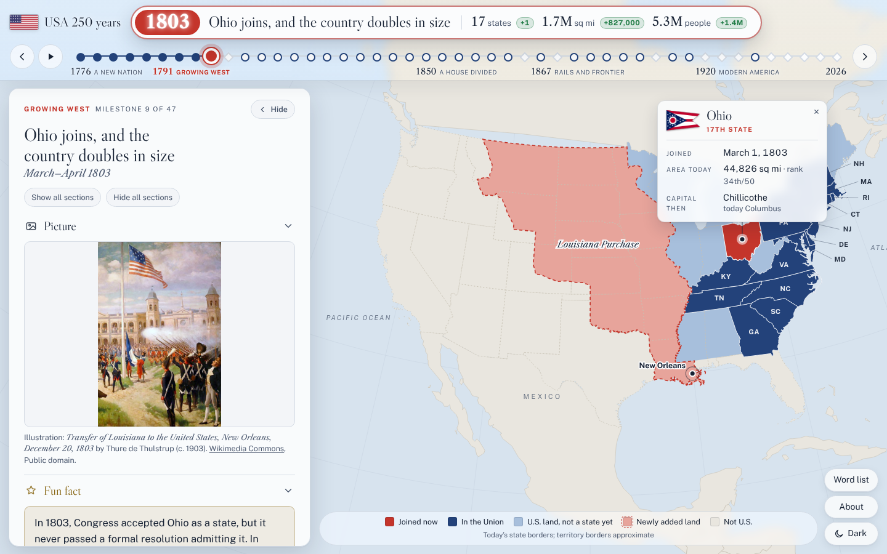

# USA at 250

An interactive map and timeline of how the United States grew from 13 states to 50, from the Declaration of Independence (1776) to the nation's 250th anniversary (2026).

It is written for a general audience and for people learning English. Each milestone tells what happened and why, and names one person who helped make it happen. It also has short sections on **the progress**, **the promise** and **the cost** of that moment.



## Features

- **47 milestones.** Every year a new state joined the Union, plus turning points such as the Treaty of Paris (1783), the end of slavery (1865), the transcontinental railroad (1869), women's suffrage (1920), the Moon landing (1969) and America at 250 (2026).
- **A full-screen map of the United States that changes at each step.** At each milestone the map flies in to the states that join or the land that is added (pulling back first when the jump is far), and shows the whole country for milestones without new states or land. Alaska, Hawaii and Puerto Rico appear in inset boxes, as on a classic U.S. map, once they become U.S. land. It shows:
  - states already in the Union
  - states that join at that milestone
  - U.S. land that was not yet a state
  - the states that left the Union in 1861–65
  - each territorial acquisition, outlined in the year it happened (Louisiana Purchase, Florida, Texas, Oregon, Mexican Cession, Gadsden Purchase, Alaska, Hawaii and Puerto Rico)
- **One page to read the story.** A reading column on the left of the map holds the whole milestone in order: the picture, a fun fact, any land added, what happened, why, the key person, and the progress, the promise and the cost. Any section can be hidden or shown with a click (or all at once), and the choice carries over to the next milestone. The whole column can be hidden to see the full map.
- **The flag of the day.** At the top left, next to the title “USA at 250”, the official U.S. flag in force at each milestone: the Continental Colors of 1776, the 13-star flag of 1777, the 15-stripe flag of 1795, and every star added under the Flag Act of 1818, up to today's 50-star flag (28 versions in all). Hover over or focus the flag to see its name and the years it was official.
- **State flags.** When a state joins (or, for the original 13, ratifies the Constitution), its bubble on the map shows its current official flag. The flags come from Wikimedia Commons and include Mississippi's 2021 flag and the 2024 flags of Utah and Minnesota.
- **A bubble on the map for every new state.** Each one points at its state and gives its current flag, its order (for example, 17th state), the date it joined or ratified the Constitution, its total area today with its size rank, and its capital at the time with today's capital if it changed. A single state, or states far apart, get a bubble beside each state. Several neighboring states get a neat, evenly spaced column of compact bubbles, matched to the states so that no leader lines cross. A bubble can be closed with ×; clicking the state brings it back.
- **A fun fact for every milestone,** shown just below the picture, to make each moment easy to remember. For example: the Wright brothers tossed a coin to decide who would fly first.
- **One key person per milestone,** tagged by field: politics, economy or science.
- **Written for English learners.** Sentences are short and plain. 41 harder words, such as *ratify*, *annex* and *suffrage*, show a simple meaning when tapped. A word list collects them all.
- **A timeline slider across the top**, with previous/next buttons, autoplay and keyboard navigation (← →). Above it, a large heading, centered on the page, shows the milestone's year, its one-line title, and the number of states, land area and people, with green “+” badges for how much each grew since the previous milestone (for example, +1 state, +827,000 sq mi, +1.4M people in 1803). The heading stays still as you move through the years, and the red handle on the timeline marks the current milestone. The top bar is see-through frosted glass over the full-screen map. Each era's name (A New Nation, Growing West, and so on) sits next to its first year under the timeline. Word list, About and the light/dark switch are round icon buttons at the top right; each shows its label when you hover over it.
- **Pictures with credits.** Illustrations and portraits come from Wikimedia Commons. Each one shows its title, artist, date, license and a link to its source page.
- **Easy to run and share.** It is a single static page with no server and no build step needed to view it. It has light and dark modes, with a switch at the top right, and it works on phones. Each milestone has its own link, for example `index.html#1803`.

## Getting started

Clone the repository and open `index.html` in a browser:

```bash
git clone https://github.com/richnguyen/usa-from-13-to-50.git
cd usa-from-13-to-50
open index.html            # macOS; or double-click the file
```

Or serve it locally:

```bash
python3 -m http.server 8000
# then visit http://localhost:8000
```

The page loads its fonts from Google Fonts. Everything else is in the repository.

To publish with **GitHub Pages**, go to *Settings → Pages* and choose *Deploy from a branch*, then pick `main` and the `/ (root)` folder.

## Project structure

```
.
├── index.html            # The app (generated by build/build.js)
├── img/                  # Resized illustrations (i<id>.jpg) and portraits (p<id>.jpg)
├── docs/screenshot.png
├── favicon.svg           # Browser-tab icon: the 13-star, 13-stripe flag of 1777 (plus PNG versions)
└── build/
    ├── content.js        # All milestone text, admission dates, acquisitions, census figures, glossary
    ├── regions.js        # Historical boundary lines (Mississippi River, Adams–Onís line, Continental Divide, …)
    ├── geo.js            # Projects state and acquisition shapes into SVG paths
    ├── app.html          # Page template: CSS and JavaScript
    ├── build.js          # Assembles index.html (and artifact.html, a body-only variant)
    ├── images.json       # Image credits: title, artist, date, license, source page
    ├── img-search/       # The Commons file chosen for each milestone (select.tsv) and search results
    └── tools/            # Wikimedia Commons search and download scripts (Python)
```

## Editing and rebuilding

You need Node.js 18 or later.

```bash
cd build
npm install
npm run build        # writes ../index.html and build/artifact.html
```

- **Change the text.** Edit `build/content.js`, then rebuild. Text inside `[[...]]` becomes a glossary link: `[[ratify]]`, or `[[shown text|glossary key]]`.
- **Change an image.** Edit the milestone's line in `build/img-search/select.tsv` and delete its old file in `img/`. Then run:

  ```bash
  python3 tools/fetch_images.py "$PWD" ../img
  npm run build
  ```

  The script downloads and resizes the picture and records its credit in `images.json`. Wikimedia rate-limits downloads, so a run may need repeating.

## Sources

- **Statehood and ratification dates:** U.S. National Archives and state records.
- **Land added by each acquisition:** U.S. Census Bureau and Bureau of Land Management tables of territorial acquisitions (published tables differ by under 1%, so figures are rounded).
- **State areas:** U.S. Census Bureau, 2010 census (total area, land and water). **Capitals at statehood:** state government and historical society records.
- **Population:** U.S. decennial census counts, with estimates for 1776 and 1780, and the Census Bureau's 2024 estimate.
- **Map data:** U.S. Census Bureau cartographic boundaries via [us-atlas](https://github.com/topojson/us-atlas), and [Natural Earth](https://www.naturalearthdata.com/) via [world-atlas](https://github.com/topojson/world-atlas).
- **Images:** [Wikimedia Commons](https://commons.wikimedia.org/). Credits for each image are listed in `build/images.json` and in the app's *About* panel.

### Accuracy notes

- The map uses **today's state borders**. The borders of territorial acquisitions are approximate and follow standard U.S. history atlases. The 1818 Red River Basin is shown as part of the Louisiana Purchase, and Hawaii is drawn in an inset.
- The text was checked against published sources. Corrections are welcome: please open an issue with a source.

## License

The code and text in this repository are released under the [MIT License](LICENSE).

Third-party material keeps its own license:

- **Images** in `img/` come from Wikimedia Commons. Most are in the public domain, and some are under Creative Commons licenses (CC BY or CC BY-SA). The license and author of each image are recorded in `build/images.json` and shown in the app. They are **not** covered by the MIT License.
- **Map data** from us-atlas and world-atlas is under the ISC License. Natural Earth data is in the public domain.
